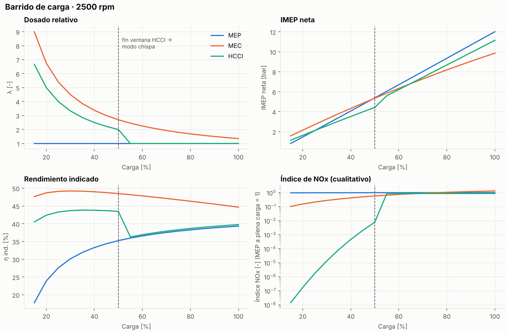
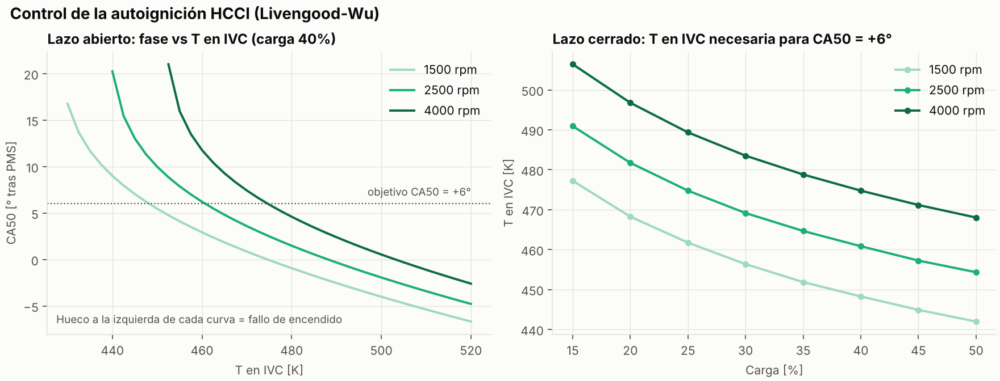

# MEP, MEC y HCCI: cómo queman, por qué y qué los limita

Informe técnico que acompaña al modelo de este repositorio. Está organizado alrededor de preguntas concretas (las hipótesis que surgieron al estudiar los tres motores), cada una con su respuesta. Los resultados numéricos salen del modelo 0D descrito en el [README](README.md) y se pueden reproducir en el [simulador interactivo](https://maikelgth.github.io/motores-termicos/comparativa-mep-mec-hcci/).

**Contenido**

1. [Los tres motores de un vistazo](#1-los-tres-motores-de-un-vistazo)
2. [Premezcla y difusión](#2-premezcla-y-difusión)
3. [MEP: mezcla homogénea y estratificada](#3-mep-mezcla-homogénea-y-estratificada)
4. [MEC: inyección, movimiento del aire y hollín](#4-mec-inyección-movimiento-del-aire-y-hollín)
5. [HCCI y SPCCI](#5-hcci-y-spcci)
6. [Hipótesis planteadas](#6-hipótesis-planteadas)
7. [Combustión anómala y fallos mecánicos](#7-combustión-anómala-y-fallos-mecánicos)
8. [Lo que dice el modelo](#8-lo-que-dice-el-modelo)
9. [Referencias](#9-referencias)

---

## 1. Los tres motores de un vistazo

| | MEP (gasolina) | MEC (diésel) | HCCI |
|---|---|---|---|
| Relación de compresión | 9:1 a 13:1 (hasta 14:1 con gasolina de alto octanaje y control de picado) | 15:1 a 22:1 (DI moderno 15–18; IDI hasta 22–23) | 12:1 a 18:1 |
| Mezcla al encender | Premezclada y homogénea, λ = 1 (estratificada en algunos GDI a carga parcial) | Heterogénea: chorro de líquido en aire caliente | Premezclada, homogénea y pobre (λ ≈ 2–4) o muy diluida con EGR |
| Inicio de la combustión | Chispa: lo fija el avance de encendido | Autoignición tras la inyección: lo fija el instante de inyección | Autoignición de toda la carga: lo fija la química (p, T, composición) |
| Tipo de llama | Frente de llama turbulento que barre la cámara | Fase premezclada corta y llama de difusión | Sin frente de llama: reacción casi simultánea en todo el volumen |
| Control de la carga | Por cantidad: mariposa (pérdidas de bombeo) | Por calidad: cantidad de combustible, sin mariposa | Por calidad, dentro de una ventana estrecha |
| Contaminantes críticos | CO, HC y NOx, que se tratan juntos con el catalizador de tres vías | NOx y hollín | HC y CO (combustión fría); NOx muy bajo |
| Postratamiento típico | Catalizador de tres vías (TWC); filtro de partículas en GDI | DOC + DPF + SCR (urea) o trampa de NOx (LNT) | Catalizador de oxidación |
| Limitación principal | Picado: limita la relación de compresión | Mezcla: limita el régimen; compromiso NOx-hollín | Control de la autoignición; ventana de carga estrecha |

---

## 2. Premezcla y difusión

Una **llama de premezcla** quema una mezcla en la que combustible y aire ya estaban juntos antes de encender. Es la del MEP: la chispa crea un núcleo y un frente de llama avanza por la cámara consumiendo la mezcla fresca.

Una **llama de difusión** quema combustible y aire que llegan separados. La reacción solo ocurre en la superficie donde se encuentran, y la velocidad de combustión queda limitada por lo rápido que se mezclan. Es la del MEC (y la de una vela).

Dos correcciones habituales:

- **La llama de premezcla no es supersónica.** Es una deflagración. La velocidad laminar de una gasolina estequiométrica es de unos 0,3–0,5 m/s; la turbulencia de la cámara la multiplica hasta del orden de 10 m/s, frente a velocidades del sonido de 500–900 m/s en el gas caliente. La combustión de un MEP dura 40–60° de cigüeñal porque la turbulencia crece con el régimen.
- **La llama de difusión no es "lenta" en sí.** Su velocidad la marca la mezcla, y la mezcla depende de la energía del chorro y del movimiento del aire. Lo que limita al diésel es que, a alto régimen, el tiempo disponible (en milisegundos) se acorta más rápido de lo que se puede acelerar la mezcla. Por eso los diésel de turismo rara vez pasan de 4500–5000 rpm.

**Por qué un MEP no usa difusión.** La gasolina resiste la autoignición (es lo que mide el octanaje), así que no arde de forma fiable al entrar en el aire comprimido. Además, el catalizador de tres vías solo funciona en una ventana muy estrecha alrededor de λ = 1 (del orden de ±0,5 %). Una combustión de difusión, con zonas ricas y pobres, generaría hollín y CO en unas y NOx en otras.

---

## 3. MEP: mezcla homogénea y estratificada

### Homogénea

El combustible entra durante la admisión (inyección en el colector, PFI, o directa temprana, GDI) y tiene toda la admisión y la compresión para mezclarse. En la bujía hay mezcla estequiométrica y el frente de llama puede recorrer toda la cámara. Es el modo de plena carga, porque aprovecha todo el aire.

### Estratificada

Solo es posible con **inyección directa**. A carga parcial se abre la mariposa y se inyecta tarde, al final de la compresión, para formar una nube inflamable alrededor de la bujía rodeada de aire o de mezcla muy pobre. Globalmente la mezcla es pobre.

- **Por qué reduce el bombeo.** En un MEP homogéneo la carga se regula estrangulando el aire con la mariposa. El pistón aspira contra un vacío en el colector y ese trabajo se pierde: es el bombeo (PMEP). Con la mariposa abierta y la carga regulada con el combustible, como en un diésel, el bombeo casi desaparece. En el modelo, el MEP al 40 % de carga pierde 0,66 bar de PMEP frente a 0,05 bar del HCCI.
- **Por qué no causa picado.** El picado lo produce la autoignición del gas sin quemar de la periferia (*end-gas*). Si esa zona es aire o mezcla muy pobre, el riesgo baja mucho. "Imposible" es demasiado: la estratificación nunca es perfecta. En la práctica el picado deja de ser el límite a carga parcial.
- **Cuándo se usa.** A carga parcial y régimen moderado: crucero, ciudad a velocidad constante. Al pedir par, la centralita vuelve a homogénea con λ = 1 (o algo rica a plena carga). En retención se corta la inyección.
- **El problema que no se suele contar.** Con mezcla pobre el catalizador de tres vías no reduce NOx, porque sobra oxígeno en el escape. Los GDI estratificados necesitan una **trampa de NOx (LNT)**: almacena el NOx en forma de nitratos durante el funcionamiento pobre y lo reduce con breves pulsos ricos. Es sensible al azufre del combustible. Ese coste, unido a las normas Euro 6, hizo que la mayoría de fabricantes abandonasen la estratificación y volviesen a GDI homogéneo con λ = 1.

**Inyección y chispa.** En homogéneo están separadas: inyección en admisión, chispa al final de la compresión. En estratificado, el final de la inyección y la chispa quedan muy próximos (unos pocos grados de cigüeñal), porque la chispa tiene que coincidir con la nube en la bujía.

**Cómo se lleva la nube a la bujía.**

- **Guiado por pared.** El chorro choca con un cuenco asimétrico del pistón que lo desvía hacia la bujía, ayudado por el tumble. Es simple, pero moja el pistón: aumentan los HC y las partículas.
- **Guiado por chorro.** Un inyector central (piezoeléctrico en BMW N53 o Mercedes CGI) pulveriza junto a la bujía y la nube se forma en el aire, sin tocar el pistón. Es más limpio, pero muy sensible a la posición de la bujía y al ensuciamiento.

---

## 4. MEC: inyección, movimiento del aire y hollín

Al final de la compresión de un diésel el aire está a 40–100 bar y **700–900 K** (unos 430–630 °C; más con turbo). El modelo da unos 890 K con rc = 17,5. A esas condiciones el gasóleo se autoinflama con un retraso de encendido de alrededor de 1 ms.

### Heterogénea, pero buscando mezclar

La mezcla del diésel es heterogénea por naturaleza: chorro líquido, gotas que se evaporan, vapor rico y aire. El objetivo no es "homogeneizar" antes de quemar, sino mezclar el combustible con el oxígeno lo más rápido posible mientras arde. Donde falta oxígeno se forma hollín, y donde la mezcla está cerca de λ = 1 la temperatura de llama es máxima y se forma NOx. Ese es el compromiso NOx-hollín del diésel.

### Movimiento del aire

Tomando el eje del cilindro como eje z:

- **Swirl.** Rotación del aire alrededor del eje z. Se genera en la admisión con conductos helicoidales o tangenciales y se mantiene durante la compresión. Típico del diésel.
- **Tumble.** Rotación alrededor de un eje horizontal, perpendicular al del cilindro. Se genera con conductos de admisión casi verticales. Al comprimirse se rompe en turbulencia fina. Típico del MEP.
- **Squish.** Flujo radial hacia el centro cerca del PMS, cuando la corona plana del pistón se acerca a la culata y expulsa el gas hacia el cuenco (*bowl*).

El diésel necesita más intensidad de mezcla que el MEP porque dispone de milisegundos en vez de una carrera completa.

### IDI y DI

- **IDI (inyección indirecta).** Se inyecta en una precámara (de turbulencia o de combustión) unida al cilindro por un canal. El aire entra en ella a gran velocidad durante la compresión y la mezcla es fácil, con presiones de inyección moderadas (del orden de 100–400 bar). A cambio tiene más superficie de pared y pérdidas de calor y por estrangulamiento: consume más, necesita relaciones de compresión altas (20–23:1) y bujías de precalentamiento para arrancar.
- **DI (inyección directa).** Se inyecta en el cuenco del pistón. La energía de mezcla la aporta el propio chorro, con presiones de common rail de 1600–2700 bar y orificios de ~0,1 mm. Es más eficiente y ha desplazado a la IDI en turismos.

### Secuencia de inyección (common rail)

La inyección no es continua: la centralita reparte el combustible en varios pulsos por ciclo.

1. **Piloto (una o dos).** Pequeñas cantidades antes de la principal. Calientan la carga y acortan el retraso de la principal, así que se acumula menos combustible antes de encender y la fase premezclada es más suave. Reducen ruido (el "picado diésel") y NOx.
2. **Principal.** El grueso del combustible. Puede partirse para controlar la forma de la liberación de calor, el ruido y las emisiones. No busca una "combustión isobara real": el ciclo Diesel isobaro es una idealización.
3. **Post-inyección cercana.** Justo después de la principal. Se quema y aporta turbulencia y temperatura que ayudan a oxidar el hollín formado.
4. **Post-inyección tardía.** En plena expansión, cuando ya no se quema en el cilindro. El combustible llega al catalizador de oxidación (DOC), se oxida allí y eleva la temperatura del escape para regenerar el filtro de partículas. Su efecto secundario es que parte del combustible acaba en el aceite (dilución).

### El hollín

El hollín son partículas de carbono sólido. Se forma en zonas ricas a 1600–2400 K: el combustible se descompone (pirólisis), forma hidrocarburos aromáticos policíclicos (PAH), estos nuclean partículas primarias de 15–40 nm, que crecen y se aglomeran en cadenas de ~100 nm. La mayor parte se vuelve a oxidar dentro del cilindro; lo que sale es la diferencia entre formación y oxidación.

Supone energía química desperdiciada, ensucia la EGR y el turbo, y es un riesgo sanitario: la IARC clasifica el escape diésel como cancerígeno (grupo 1) desde 2012.

**El filtro de partículas (DPF)** retiene más del 95 % de las partículas en masa y hay que regenerarlo:

- **Regeneración pasiva.** El NO₂ que genera el DOC oxida el hollín a 250–450 °C, en uso normal.
- **Regeneración activa.** Se sube el escape a ~600 °C con post-inyección tardía para quemar el hollín con oxígeno.

---

## 5. HCCI y SPCCI

### HCCI

Se crea una mezcla homogénea y pobre (o diluida con EGR) y la compresión la lleva a la autoignición, que ocurre casi a la vez en todo el volumen.

- **Ventajas.**
  - Sin mariposa ni bombeo, con relación de compresión alta y combustión rápida cerca del PMS, el rendimiento se acerca al del diésel.
  - La mezcla pobre o diluida mantiene la temperatura de combustión baja, por debajo de unos 1800–1900 K, así que el NOx es **muy bajo** (no cero).
  - Al no haber zonas ricas, el hollín es prácticamente nulo.
- **Inconvenientes.**
  - A muy baja carga la combustión queda tan fría (por debajo de unos 1500 K) que el CO no termina de oxidarse y los HC suben: cae el rendimiento de combustión.
  - Por arriba, la carga está limitada por el **ringing**: al liberar el calor de golpe, el gradiente de presión supera el límite habitual de 5–10 bar/° y aparecen oscilaciones de presión parecidas al picado.
  - El resultado es una ventana útil de carga estrecha.
- **El problema de control.** En un MEP el inicio lo marca la chispa y en un MEC la inyección. En el HCCI lo marca la cinética química, que depende de la temperatura y la presión en el cierre de admisión, de la composición (λ, EGR, residuales), del combustible y de la temperatura de las paredes. En transitorios, como pasar de retención a acelerar, todo eso cambia de un ciclo a otro. Los extremos son el fallo de encendido y el ringing. El término *super-knock* no se aplica aquí: designa la pre-ignición a bajo régimen de los MEP turbo (LSPI, sección 7).

**Cómo se controla en la práctica.** Actuando sobre la temperatura de la carga:

- **Retención de gases calientes** mediante cruce negativo de válvulas (NVO) o reapertura de la válvula de escape.
- **EGR caliente o refrigerada.**
- **Calentamiento de la admisión.**
- **Relación de compresión variable.**
- **Estratificación térmica o de dosado.** Alarga la combustión y suaviza el ringing.

El modelo de este repositorio reproduce la primera palanca. Calcula la autoignición con la integral de Livengood-Wu y busca la temperatura de cierre de admisión que coloca el CA50 en su objetivo.

### SPCCI (Mazda Skyactiv-X)

Es la primera aplicación comercial de encendido por compresión con gasolina. No es HCCI puro: usa la chispa para decidir el momento de la autoignición.

1. **Mezcla de fondo.** Una inyección temprana forma una mezcla pobre y homogénea en casi todo el cilindro. Es demasiado pobre para que una chispa la encienda de forma fiable, pero queda cerca de la autoignición al final de la compresión.
2. **Zona inflamable en la bujía.** Una segunda inyección, tardía y pequeña, enriquece la zona de la bujía. En global la mezcla sigue siendo pobre; solo esa zona queda cerca de λ = 1.
3. **Chispa.** Enciende esa zona y genera un frente de llama convencional.
4. **Autoignición del resto.** La expansión de esa bola de fuego comprime el resto de la carga, que llega a la autoignición. No es una detonación: es la combustión por compresión controlada que se buscaba. Variando el avance de la chispa se controla cuándo ocurre.

Mazda no ha publicado un reparto exacto entre las dos inyecciones, así que no conviene citar porcentajes.

El motor lleva además:

- **Compresor volumétrico ("air supply").** Para poder meter el exceso de aire que exige la mezcla pobre.
- **Sistema híbrido ligero de 24 V.**

La relación de compresión fue de 16,3:1 en el lanzamiento y bajó a 15,0:1 en la versión actualizada (e-Skyactiv X). Fuera de su ventana trabaja como un MEP convencional, por ejemplo en arranque en frío o a alto régimen. Se ha vendido en Europa (Mazda3, CX-30) y nunca en EE. UU. Mazda prepara como sucesor el Skyactiv-Z; conviene comprobar la disponibilidad actual antes de citarla.

---

## 6. Hipótesis planteadas

### H1. ¿La mezcla estratificada no es altamente inflamable y propensa al picado?

No. Ver [sección 3](#estratificada). La zona rica está en la bujía y quema con un frente de llama controlado. La periferia, donde se produce el picado, tiene aire o mezcla muy pobre. El inconveniente real no es el picado sino el NOx: con mezcla pobre el catalizador de tres vías no lo reduce y hace falta una trampa de NOx.

### H2. ¿Por qué el diésel genera partículas y la gasolina premezclada no?

Por las zonas ricas de la llama de difusión, donde el combustible se descompone sin oxígeno suficiente ([sección 4](#el-hollín)). Una premezcla homogénea a λ = 1 casi no forma hollín. Con inyección directa de gasolina sí aparecen partículas, por el combustible que moja paredes y pistón. Por eso los GDI modernos llevan filtro de partículas (GPF).

### H3. Si la gasolina resiste la autoignición, ¿por qué no un MEC de gasolina?

**Existe, y se investiga activamente.** Se llama GCI (*gasoline compression ignition*) o PPC (*partially premixed combustion*). Lo han desarrollado, entre otros, Delphi (GDCI), Saudi Aramco y la Universidad de Lund.

El argumento de que "el retraso es tan largo que todo explota de golpe" no es correcto. El largo retraso de encendido de la gasolina es justo lo que se aprovecha: da tiempo a premezclar parte del combustible antes de que empiece a arder. Así se reducen a la vez el hollín y el NOx, que es lo que el diésel no consigue. El retraso se controla con varias inyecciones y con la proporción de EGR.

Las dificultades reales son tres:

- **Baja carga y arranque en frío.** La gasolina no llega a autoinflamarse; se recurre a calentar la admisión o retener residuales.
- **Ruido a alta carga.**
- **Sistema de inyección.** Necesita una bomba de alta presión capaz de trabajar con gasolina, que lubrica peor que el gasóleo.

Las temperaturas de autoignición que se suelen citar (~250–460 °C para gasolina según su composición, ~210–260 °C para gasóleo) salen de un ensayo a presión atmosférica (ASTM E659). Para un motor lo relevante es el retraso de encendido a la presión y temperatura del cilindro, que es lo que miden el octanaje y el cetanaje.

### H4. En el HCCI, ¿por qué no inyectar desde el PMI o en varios pulsos, como un diésel, para controlar el encendido?

Hay que separar dos ideas.

- **La premisa "no se puede liberar energía mientras el pistón sube" es falsa.** Todos los motores empiezan a quemar antes del PMS. En un MEP la chispa salta 20–40° antes y en un MEC la inyección empieza antes del PMS. Lo que se optimiza es la fase: el CA50 óptimo está en torno a 8–10° después del PMS. Liberar demasiada energía demasiado pronto sí es malo: trabajo negativo, picos de presión y, en el límite, pre-ignición.
- **Inyectar pronto para "calentar" la carga tiene un equivalente real.** En HCCI con cruce negativo de válvulas (NVO) se inyecta parte del combustible durante el NVO, sobre los gases calientes retenidos. Ese combustible se reforma o se quema en parte y adelanta la autoignición del ciclo siguiente. Es una palanca de control estudiada desde principios de los 2000. Inyectar en el PMI sin más no sirve: el aire está frío y el combustible solo se mezcla.
- **Inyectar tarde en varios pulsos** destruye la homogeneidad y lleva a zonas ricas y llamas de difusión. Eso ya no es HCCI, es la combustión parcialmente premezclada de la H3. No es inviable: es otro concepto, con otro compromiso de emisiones.

### H5. ¿Por qué no premezclar aire y gasolina fuera y meter la mezcla a presión en el PMS?

Es inviable por tres motivos.

1. **Temperatura.** Comprimir isentrópicamente una mezcla gaseosa de 1 a ~100 bar multiplica su temperatura por 1000,286 ≈ 3,7: de 300 K a unos 1100 K. Se autoinflamaría en el compresor o en el conducto. Con combustible líquido (common rail, GDI) no pasa: el líquido apenas se calienta al comprimirlo y en el circuito no hay oxígeno.
2. **Trabajo.** Comprimir gas a esas presiones cuesta un trabajo del orden del que produce el propio motor. Bombear líquido cuesta muy poco.
3. **Homogeneidad.** Una mezcla inyectada en el PMS sobre aire comprimido formaría una nube rodeada de aire: sería combustión estratificada, no HCCI.

Lo que sí existe es la **inyección directa asistida por aire** (Orbital, usada en motos de 2T y fuerabordas). Un soplo de aire a 5–10 bar atomiza el combustible durante la admisión o el principio de la compresión.

### H6. ¿Cómo funciona realmente la zona rica junto a la bujía en el SPCCI?

Ver [sección 5](#spcci-mazda-skyactiv-x). La idea de inyección partida es correcta. Lo que hay que quitar son el reparto 90/10, que no está documentado, y la palabra "detonación". La zona de la bujía es inflamable porque la segunda inyección, más tardía, no tiene tiempo de diluirse en todo el cilindro. Aun así, la mayor parte del combustible está en la mezcla pobre de fondo, porque esa mezcla ocupa casi todo el volumen.

### H7. ¿Cómo limpia el escape un HCCI o SPCCI si el catalizador de tres vías no funciona con exceso de oxígeno?

- **NOx.** El NO térmico se forma por el mecanismo de Zeldovich (O + N₂ → NO + N; N + O₂ → NO + O). Su velocidad crece de forma exponencial con la temperatura: con oxígeno atómico en equilibrio, proporcional a T−½·exp(−69 090/T). No hay un umbral: por debajo de ~1800 K (~1530 °C) la tasa se hace pequeña y por encima se dispara. El HCCI pobre quema por debajo de ese rango, así que forma **muy poco** NOx (no cero). En el modelo, unas 2000 veces menos que el MEP en el mismo punto.
- **CO y HC.** Con oxígeno sobrante, el catalizador funciona como catalizador de oxidación y los convierte en CO₂ y agua. Esto es necesario, porque la combustión fría del HCCI emite más CO y HC que un MEP.
- **Fuera de la ventana pobre.** Al pedir par el motor vuelve a λ = 1. El NOx sube, pero entonces el catalizador de tres vías sí lo reduce.

---

## 7. Combustión anómala y fallos mecánicos

| Fallo | Qué ocurre | Dónde | Daños típicos |
|---|---|---|---|
| **Fallo de encendido** (*misfire*) | La mezcla no se enciende o la llama se apaga | MEP (chispa débil, mezcla fuera de límites); MEC en frío; HCCI con carga demasiado fría o pobre | HC sin quemar al escape; el catalizador puede sobrecalentarse al oxidarlos; tirones |
| **Picado** (*knock*) | El *end-gas* se autoinflama antes de que llegue el frente de llama | MEP | Ver abajo |
| **Pre-ignición** | La mezcla se enciende antes de la chispa por un punto caliente | MEP | Pistón perforado, zona de segmentos rota; puede derivar en picado severo |
| **LSPI / super-knock** | Pre-ignición aleatoria a bajo régimen y alta carga, iniciada por gotas de aceite o depósitos | MEP turbo de inyección directa | Picos de presión muy por encima de los de diseño: zona de segmentos rota, bielas dobladas en un solo ciclo |
| **Picado diésel** | Fase premezclada demasiado violenta por un retraso de encendido largo (frío, bajo cetano) | MEC | Ruido; con cargas altas, fatiga. Se corrige con inyección piloto |
| **Ringing** | Liberación de calor demasiado rápida; gradiente de presión excesivo | HCCI | Oscilaciones de presión, ruido y fatiga de pistón y segmentos |
| **Gripaje** | Contacto metal-metal entre pistón y camisa al romperse la película de aceite | Todos (clásico en 2T) | Arrastre, material soldado, motor bloqueado |

### Picado

El *end-gas*, comprimido y calentado por el frente de llama que avanza, alcanza la autoignición y libera su energía de golpe. Eso excita ondas de presión en la cámara: oscilaciones acústicas a la frecuencia de resonancia del cilindro, de 5 a 20 kHz. No son "ondas supersónicas que martillean la biela". El primer modo circunferencial vale

$$f \approx \frac{1{,}84\,c}{\pi B}$$

Para B = 86 mm y c ≈ 900 m/s da unos 6 kHz. Es el ruido metálico característico y lo que detectan los sensores de picado.

**Por qué daña.** Las oscilaciones rompen la capa límite térmica junto a las paredes y disparan el flujo de calor local.

- **Daños típicos.** Erosión de la corona del pistón en la zona del *end-gas* (aspecto de picaduras), rotura de la zona de segmentos y sobrecalentamiento del pistón, que puede acabar en gripaje.
- **Con picado severo y sostenido.** Pueden sufrir los cojinetes de biela y la junta de culata. Tras un episodio grave conviene revisar bielas y cojinetes, pero el daño primario está en el pistón.

**Por qué limita la relación de compresión del MEP.** El MEP comprime mezcla, no aire. Subir la relación de compresión eleva la presión y la temperatura del *end-gas*, y el límite lo pone el octanaje del combustible. Con gasolina de 95 octanos (RON) eso deja la relación en torno a 10–12:1 (13–14:1 con soluciones específicas). El diésel comprime solo aire y el problema no existe.

### Pre-ignición y LSPI

La pre-ignición enciende la mezcla durante la compresión, antes de la chispa, por un electrodo o una válvula demasiado calientes o por depósitos incandescentes. La combustión empieza demasiado pronto, la presión máxima llega antes del PMS y el pistón recibe un flujo de calor muy alto. El daño típico es un agujero fundido en el centro de la corona.

El LSPI es su versión en los MEP turbo modernos: ocurre a bajo régimen y alta carga, de forma aleatoria. Puede romper la zona de segmentos o doblar una biela en uno o pocos ciclos. Los aceites con formulación anti-LSPI (normas API SP e ILSAC GF-6) se crearon para eso.

### Gripaje

Es un fallo mecánico, no de combustión, aunque una combustión anómala puede provocarlo. Se produce cuando la película de aceite entre pistón y camisa se rompe. Las causas habituales son:

- **Falta de aceite o aceite degradado.**
- **Sobrecalentamiento.** El pistón de aluminio dilata más que la camisa y se come la holgura.
- **Picado sostenido.** Sobrecalienta el pistón.

Es clásico en los motores de 2T con lubricación por mezcla. Si la mezcla entra pobre, entra a la vez menos aceite y el motor se calienta más.

---

## 8. Lo que dice el modelo

Punto de referencia: 40 % de carga, 2500 rpm, misma geometría para los tres motores (2,0 L).

| | MEP | MEC | HCCI |
|---|---|---|---|
| λ | 1,00 | 3,38 | 2,50 |
| Bombeo, PMEP [bar] | 0,66 | 0,05 | 0,05 |
| Rendimiento indicado [%] | 33,3 | 49,0 | 43,8 |
| p máx [bar] | 25,6 | 61,1 | 48,3 |
| dp/dθ máx [bar/°] | 1,09 | 4,46 | 3,74 |
| T máx media [K] | 2674 | 1425 | 1990 |
| Índice de NOx (MEP = 1) | 1 | 0,43 | 0,0005 |

- **MEP.** El bombeo explica la mayor parte de su desventaja a carga parcial.
- **MEC.** Su temperatura *media* es la más baja, pero su NOx no lo es. La llama de difusión arde localmente a λ ≈ 1 y es esa temperatura local la que cuenta. Un modelo de una sola zona no lo capta; el índice de NOx del modelo lo corrige evaluando la cinética a la temperatura de llama estequiométrica.
- **HCCI.** Queda cerca del diésel en rendimiento, con un NOx varios órdenes de magnitud menor. A cambio exige mantener la temperatura de cierre de admisión dentro de una ventana de unos 50 K (figura de control).

**Límites del modelo.** Es una herramienta para entender tendencias y mecanismos; no predice valores absolutos.

- **Ciclo cerrado ideal**, sin intercambio de gases.
- **Rendimiento volumétrico supuesto**, no calculado.
- **Correlación de autoignición extrapolada** por encima de 23 atm.
- **Duración de la combustión del HCCI fija.** Por eso no capta que adelantar la fase también acelera la combustión.
- **Índice de NOx cualitativo**, que no da ppm.

Están todos detallados en el [README](README.md#hipótesis-y-limitaciones).

---

## 9. Referencias

- Heywood, J. B. *Internal Combustion Engine Fundamentals*, 2.ª ed. McGraw-Hill, 2018. Formación de NO (cap. 11), combustión en MEP y MEC (caps. 9–10), picado (cap. 9).
- Zhao, F., Lai, M.-C., Harrington, D. L. "Automotive spark-ignited direct-injection gasoline engines". *Progress in Energy and Combustion Science* 25, 1999.
- Dec, J. E. "Advanced compression-ignition engines: understanding the in-cylinder processes". *Proceedings of the Combustion Institute* 32, 2009.
- Eng, J. A. "Characterization of pressure waves in HCCI combustion". SAE 2002-01-2859.
- Kalghatgi, G. T. et al. "Advantages of fuels with high resistance to auto-ignition in late-injection, low-temperature, compression ignition combustion". SAE 2006-01-3385.
- Sellnau, M. et al. "Full-time gasoline direct-injection compression ignition (GDCI) for high efficiency and low NOx and PM". SAE 2012-01-0384.
- Livengood, J. C., Wu, P. C. "Correlation of autoignition phenomena in internal combustion engines and rapid compression machines". *5th Symp. (Int.) on Combustion*, 1955.
- He, X. et al. "An experimental and modeling study of iso-octane ignition delay times under HCCI conditions". *Combustion and Flame* 142, 2005.
- IARC. *Diesel and gasoline engine exhausts and some nitroarenes*. Monographs vol. 105, 2014.
- SlashGear. "What happened to the Mazda Skyactiv-X engine?". Relaciones de compresión y mercados del Skyactiv-X.
