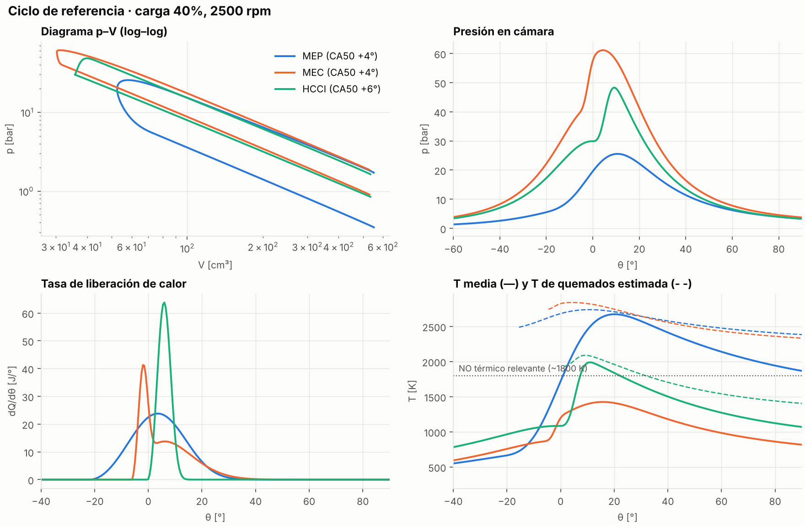
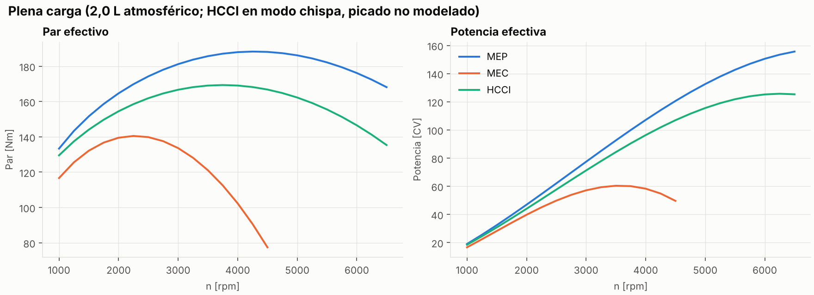

# Comparativa 0D de ciclos MEP, MEC y HCCI

Modelo termodinámico de ciclo cerrado para comparar un motor de gasolina convencional (MEP), un diésel (MEC) y un motor de combustión por autoignición de carga homogénea (HCCI) **con la misma geometría** (2,0 L, 4 cilindros, atmosférico). Así la comparativa aísla el efecto del proceso de combustión y de la estrategia de control de carga.

El punto central es el **control de la autoignición del HCCI**. El inicio de combustión no se impone: se calcula con la integral de Livengood-Wu y un lazo cerrado ajusta la temperatura de cierre de admisión para mantener el CA50 en su objetivo.

**[Simulador interactivo →](https://maikelgth.github.io/motores-termicos/comparativa-mep-mec-hcci/)** Mismo modelo portado a JavaScript; funciona en el navegador.



## Resultados

Punto de referencia: 40 % de carga, 2500 rpm.

| Motor | Modo | λ | T IVC [K] | CA50 [°] | IMEP neta [bar] | η ind. [%] | p máx [bar] | dp/dθ máx [bar/°] | NOx (rel.) |
|---|---|---|---|---|---|---|---|---|---|
| MEP | Chispa, mariposa | 1.00 | 320 | +3.9 | 4.07 | 33.3 | 25.6 | 1.09 | 1.000 |
| MEC | Difusión | 3.38 | 330 | +3.9 | 4.33 | 49.0 | 61.1 | 4.46 | 0.304 |
| HCCI | Autoignición | 2.50 | 461 | +6.0 | 3.52 | 43.8 | 48.3 | 3.74 | 0.011 |

- **MEP**: el estrangulamiento hunde el rendimiento a carga parcial (bombeo). Es el motivo de fondo para buscar alternativas pobres.
- **MEC**: es el más eficiente, pero su llama de difusión arde a λ local ≈ 1, así que genera NOx aunque la mezcla global sea muy pobre.
- **HCCI**: rendimiento cercano al diésel con un NOx unas 90 veces menor que el MEP. A cambio, su ventana útil acaba en λ ≈ 2 (≈ 50 % de carga) por el gradiente de presión (*ringing*) y exige un control preciso de la temperatura de la carga.

### Barrido de carga


La línea discontinua marca el límite de la ventana HCCI. Por encima, el motor pasa a modo chispa a λ = 1, con lo que pierde la ventaja en rendimiento y en NOx.

### Control de la autoignición


- **Lazo abierto (izquierda).** Unos 20 K en la T de cierre de admisión separan el fallo de encendido del CA50 óptimo, y otros 25 K adelantan la combustión antes del PMS. Al subir el régimen hay menos tiempo para la química, así que la autoignición se retrasa y hace falta más temperatura.
- **Lazo cerrado (derecha).** A menor carga (mezcla más pobre) hace falta más temperatura. En un motor real esa temperatura se consigue reteniendo gases residuales (NVO) o con EGR caliente.

### Plena carga



El diésel atmosférico da menos par que el gasolina porque está limitado por humos (λ ≥ 1,35). Los diésel comerciales lo compensan con turbo, que este modelo no incluye.

## Modelo

**Ecuación de energía** (monozona, gas ideal, sin intercambio de masa entre IVC y EVO):

$$\frac{dp}{d\theta} = \frac{\gamma-1}{V}\left(\frac{dQ_c}{d\theta} - \frac{dQ_w}{d\theta}\right) - \gamma\,\frac{p}{V}\,\frac{dV}{d\theta}, \qquad \gamma = \gamma(T)$$

| Submodelo | Implementación |
|---|---|
| Cinemática | Biela-manivela exacta |
| Liberación de calor | Wiebe (MEP, HCCI); Wiebe doble de Watson, premezcla + difusión (MEC) |
| Pérdidas a pared | Woschni (1967) |
| Control de carga | Cantidad (mariposa + bombeo) en MEP; calidad (λ) en MEC y HCCI |
| Autoignición HCCI | Livengood-Wu con el retraso de He et al. (2005) para iso-octano |
| Control HCCI | Bisección sobre T<sub>IVC</sub> hasta alcanzar el CA50 objetivo |
| NOx | Índice cinético tipo Zeldovich sobre T de quemados estimada |
| Fricción | Chen-Flynn |

**Autoignición.** Se integra la compresión sin combustión y se busca el ángulo en el que

$$\int_{t_{IVC}}^{t_{ign}} \frac{dt}{\tau(p,T,\phi,\chi_{O_2})} = 1, \qquad \tau = 1.3\cdot10^{-4}\, p^{-1.05}\,\phi^{-0.77}\,\chi_{O_2}^{-1.41}\,e^{33700/(R_u T)}\ \text{[ms]}$$

con p en atm, χ<sub>O₂</sub> en % molar y R<sub>u</sub> en cal/(mol·K). Como antes de la autoignición no hay liberación de calor, la traza arrastrada coincide con la real y el cálculo es exacto dentro del modelo.

## Hipótesis y limitaciones

El modelo sirve para comparar tendencias y explicar mecanismos, no para predecir valores absolutos.

- Ciclo cerrado ideal (IVC = EVO = PMI). No se modelan el intercambio de gases ni los residuales: el bombeo se estima como p<sub>esc</sub> − p<sub>adm</sub>.
- Curva de rendimiento volumétrico **supuesta**, no calculada.
- La correlación de He et al. está validada en ~943–1027 K y 9–23 atm. Aquí se extrapola a presiones mayores. Además, no reproduce la liberación de calor a baja temperatura (LTHR) de gasolinas reales.
- La T<sub>IVC</sub> que da el control sustituye a un modelo de residuales: el calentamiento de la carga se representa solo con esa temperatura.
- No se modela el picado en modo chispa. El avance del HCCI en ese modo se retrasa a mano para representar ese límite.
- El índice de NOx es cualitativo y relativo al MEP; no da ppm.
- La T de quemados no considera la disociación, así que la sobreestima.
- Los coeficientes de Chen-Flynn son orientativos.

## Uso

```bash
pip install -r requirements.txt
python main.py            # genera figs/ y resultados/tabla_referencia.md (~1 min)
python main.py --rapido   # menos puntos
pytest                    # comprobaciones físicas
```

Para modificar un motor basta con editar `motor0d/config.py`. Por ejemplo, para estudiar otra relación de compresión:

```python
from motor0d import HCCI, ciclo
r = ciclo(HCCI.con(rc=17), carga=0.4, n=2500)
print(r.T_ivc, r.ca50, r.eta_i)
```

## Estructura

```
motor0d/
  config.py     parámetros de geometría y de cada motor
  modelo.py     ecuación de energía, Wiebe, Woschni, Livengood-Wu, control de CA50
  graficos.py   figuras
main.py         ejecuta la comparativa completa
tests/          comprobaciones físicas (pytest)
matlab/         versión equivalente en MATLAB
```

## Referencias

- Heywood, J. B. *Internal Combustion Engine Fundamentals*, 2.ª ed. McGraw-Hill, 2018.
- Woschni, G. "A universally applicable equation for the instantaneous heat transfer coefficient in the internal combustion engine". SAE 670931, 1967.
- Livengood, J. C., Wu, P. C. "Correlation of autoignition phenomena in internal combustion engines and rapid compression machines". *5th Symp. (Int.) on Combustion*, 1955.
- He, X. et al. "An experimental and modeling study of iso-octane ignition delay times under homogeneous charge compression ignition conditions". *Combustion and Flame* 142, 2005.
- Watson, N., Pilley, A. D., Marzouk, M. "A combustion correlation for diesel engine simulation". SAE 800029, 1980.
- Chen, S. K., Flynn, P. F. "Development of a single cylinder compression ignition research engine". SAE 650733, 1965.

## Autor

Miguel Ángel Serrano García · Ingeniería Mecánica, Universidad Politécnica de Madrid
